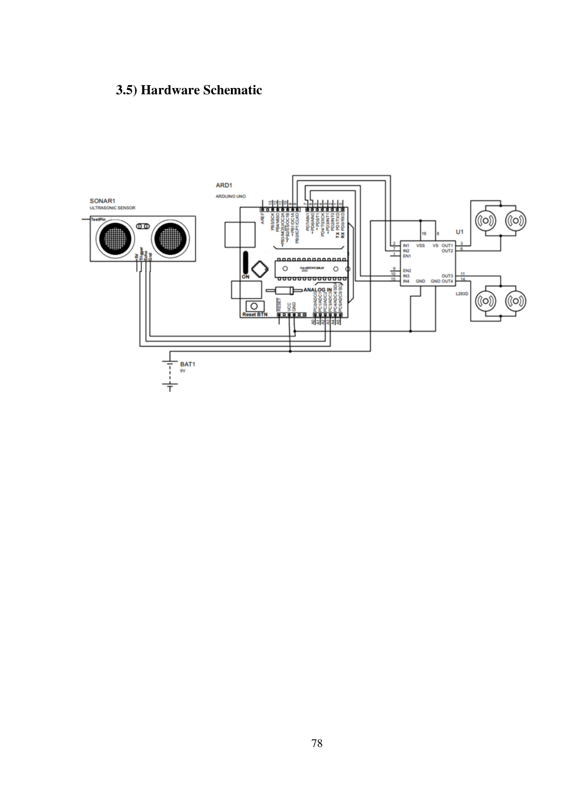
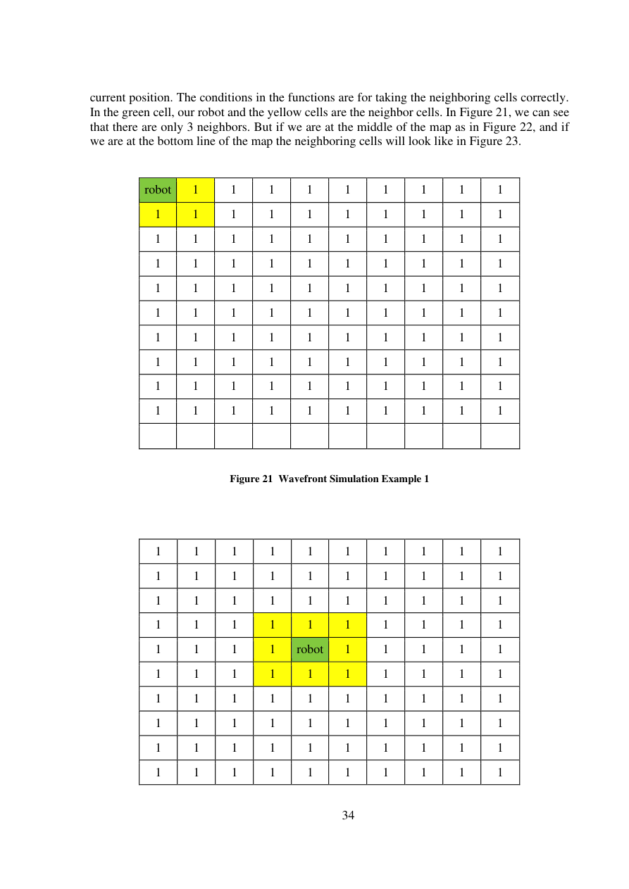

# Autonomous Carry Robot

**Robotics Systems Engineering | Embedded C/C++ | Python / OpenCV | MATLAB | Electronics**

**MEF University Senior Design Project (2021)** — Yiğit Atik and Ziya Oğuzhan Çevik; advisor Dr. Yusuf Aydın.

A documented autonomous mobile-robot research and prototype project covering **electronic hardware integration, grid-based embedded navigation, motor control, camera-based ArUco localization, and MATLAB planning/mapping simulations**. This repository preserves thesis-derived source code and original evidence while keeping historical experiments distinct from future modernization work.

> **Evidence-first archive:** The physical prototype and the MATLAB simulations are separate parts of the 2021 project. Archived source files were transcribed from thesis appendices and have **not** been fully recompiled or validated in the present environment. Python/ROS 2 modernization is planned, not completed.

## Engineering subsystems

| Area | Implementation / evidence | Technical walkthrough |
|---|---|---|
| System architecture | Prototype and simulation boundaries | [Architecture](docs/architecture/README.md) |
| Known-map planning | MATLAB `occupancyMap`, PRM, Pure Pursuit, differential drive | [Known Map](docs/matlab-simulations/known-map/README.md) |
| LiDAR SLAM simulation | MATLAB `lidarSLAM`, scan integration, loop closure | [LiDAR SLAM](docs/matlab-simulations/lidar-slam/README.md) |
| Camera calibration | OpenCV chessboard calibration | [Calibration](docs/localization/camera-calibration/README.md) |
| ArUco marker tracking | OpenCV marker detection and pose estimation | [ArUco Tracking](docs/localization/aruco-tracking/README.md) |
| Relative pose | Coordinate transformations, `composeRT` | [Relative Pose](docs/localization/relative-pose/README.md) |
| Adaptive Wavefront | Arduino/C++ 10×10 grid, neighbor evaluation | [Navigation](docs/embedded-control/adaptive-wavefront/README.md) |
| Motor control | 8 headings, 45° timed rotations, DC motors | [Motor Control](docs/embedded-control/motor-control/README.md) |
| Electronic components | Arduino, sonar, motor driver, DC motors | [Component Selection](docs/hardware/component-selection/README.md) |
| Circuit schematic | Thesis Appendix 3 schematic; Proteus source unverified | [Circuit / Proteus Evidence](docs/hardware/proteus-simulation/README.md) |
| Physical prototype | Robot build and demonstration images | [Physical Integration](docs/hardware/physical-integration/README.md) |
| Cross-subsystem limitations | Documented integration boundaries | [System Integration](docs/system-integration/README.md) |

## Selected original evidence

*Hardware schematic from thesis Appendix 3 (PDF page 81). The diagram labels an L293D driver; the original Proteus project file has not been verified.*

*Archival thesis excerpt illustrating grid-neighborhood calculations.*

## Source code and thesis

- [Arduino / C++ navigation and motor control](legacy/arduino/autonomous_carry_robot.ino)
- [Python / OpenCV calibration and localization](legacy/python/aruco_localization.py)
- [MATLAB known-map planning](legacy/matlab/path_planning/path_planning_known_map.m)
- [MATLAB LiDAR SLAM simulation](legacy/matlab/simulations/lidar_slam_simulation.m)
- [Full original thesis (PDF)](docs/thesis/Autonomous_Carry_Robot_Thesis_2021.pdf)

## Historical validation status

The original academic project was completed in 2021. The current repository is a **documentation and archival reconstruction**, not a fully reproducible modern robotics stack. In particular, the Python transcript has formatting errors; MATLAB scripts may require original datasets, toolboxes and helpers; and Arduino code has not been recompiled or tested against current hardware. Thesis images are archival page captures, not new simulation output.

## Future engineering roadmap

1. Restore and validate archival sources without changing their provenance.
2. Implement an independently testable Python grid-navigation module with unit tests and visual demos.
3. Add camera-calibration and ArUco sample data with reproducible validation.
4. Explore ROS 2 simulation and integration as a **new** development track.

## Attribution

Original senior design work: **Yiğit Atik and Ziya Oğuzhan Çevik**, MEF University, 2021. Academic advisor: **Dr. Yusuf Aydın**. MATLAB/OpenCV/Arduino libraries and APIs remain the work of their respective authors.
