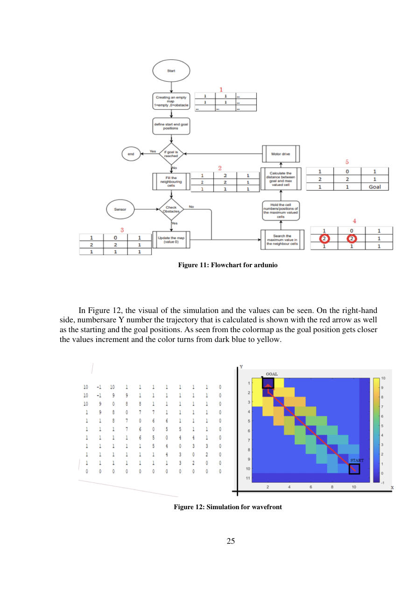
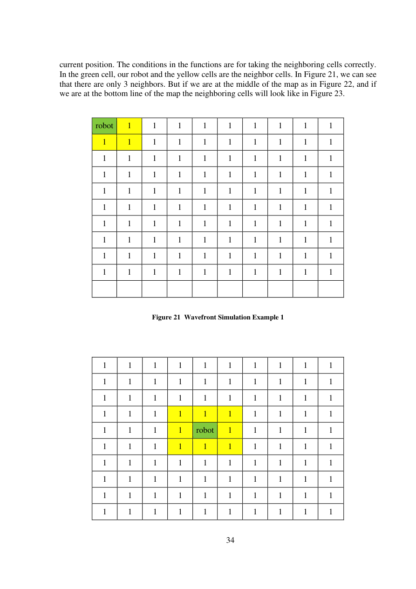
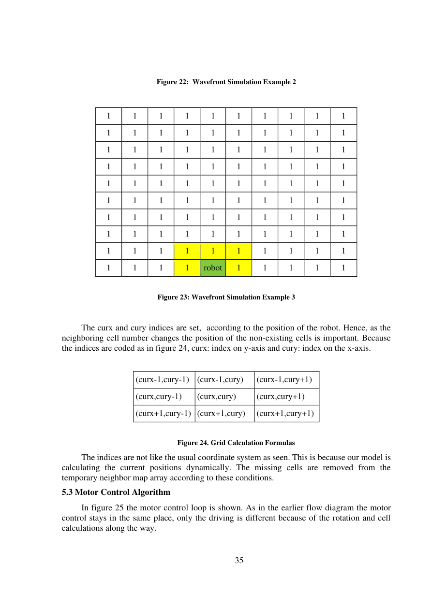

# Arduino / C++ — Adaptive Wavefront Navigation

**Thesis:** Path Planning Algorithm and implementation discussion. **Code:** [`autonomous_carry_robot.ino`](../../../legacy/arduino/autonomous_carry_robot.ino).

## Method

The archived sketch defines a **10×10** `earth` grid and encodes blocked cells as `-5`. The initial cell is `(4,4)` and the goal is `(7,7)`. `filltheMap()` updates local neighbor values with boundary-specific handling; `createSubMap()`, `findMinDistancedMaxPotentialIndex()` and related helpers select candidate cells. `loop()` updates the current grid coordinate and calls `motorControlFunction()`.

This is a local, grid-based historical algorithm. It should **not** be described as a fully verified optimal shortest-path solver or as a modern, tested BFS implementation.

## Evidence

*Wavefront/Arduino flowchart excerpt (PDF page 28). Archival full-page excerpt from the 2021 thesis; see the thesis for original figure numbering.*

*Grid neighborhood calculation excerpt (PDF page 37). Archival full-page excerpt from the 2021 thesis; see the thesis for original figure numbering.*

*Grid neighborhood example excerpt (PDF page 38). Archival full-page excerpt from the 2021 thesis; see the thesis for original figure numbering.*

## Limitations

Grid coordinates are initialized in code. The current archive does not establish live occupancy updates from ArUco localization or physical LiDAR. The sketch has not been recompiled or run against hardware in the present environment.
