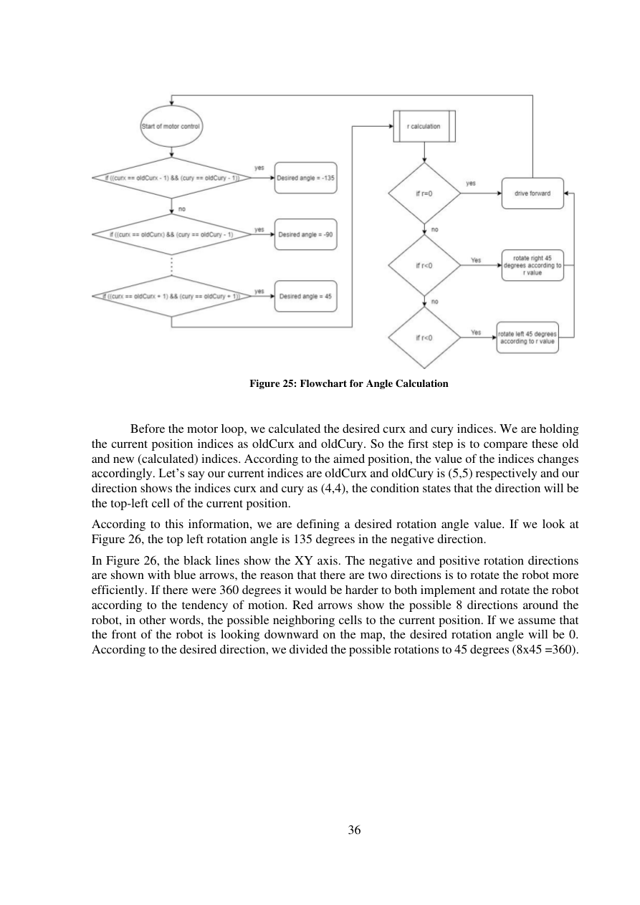
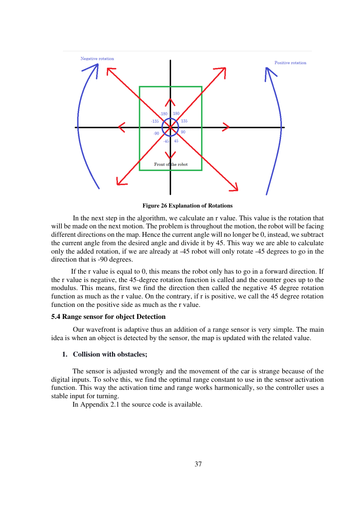

# Arduino / C++ — Motor Control and Heading Changes

**Code:** [`autonomous_carry_robot.ino`](../../../legacy/arduino/autonomous_carry_robot.ino).

## Method

`motorControlFunction()` compares old and new grid indices to select one of eight heading directions in 45° increments. It calculates `r = (desAngle - curAngle) / 45`, calls `positive45Degrees()` or `negative45Degrees()` repeatedly, and then calls `forwardDrive()`. The archived motor pins are 6, 7, 8 and 9.

The motion functions use `digitalWrite` and fixed `delay` values (e.g., 800 ms for a nominal 45° turn, 1000 ms forward for a nominal grid cell). This is **open-loop timed control**; no encoder feedback or measured heading closed-loop correction is demonstrated by these routines.

## Evidence

*Motor-control flowchart excerpt (PDF page 39). Archival full-page excerpt from the 2021 thesis; see the thesis for original figure numbering.*

*Rotation-angle diagram excerpt (PDF page 40). Archival full-page excerpt from the 2021 thesis; see the thesis for original figure numbering.*

## Limitations

Actual angles and travel distances depend on power, motor characteristics, friction, load and battery state. Timing constants are historical values, not calibrated motion guarantees.
