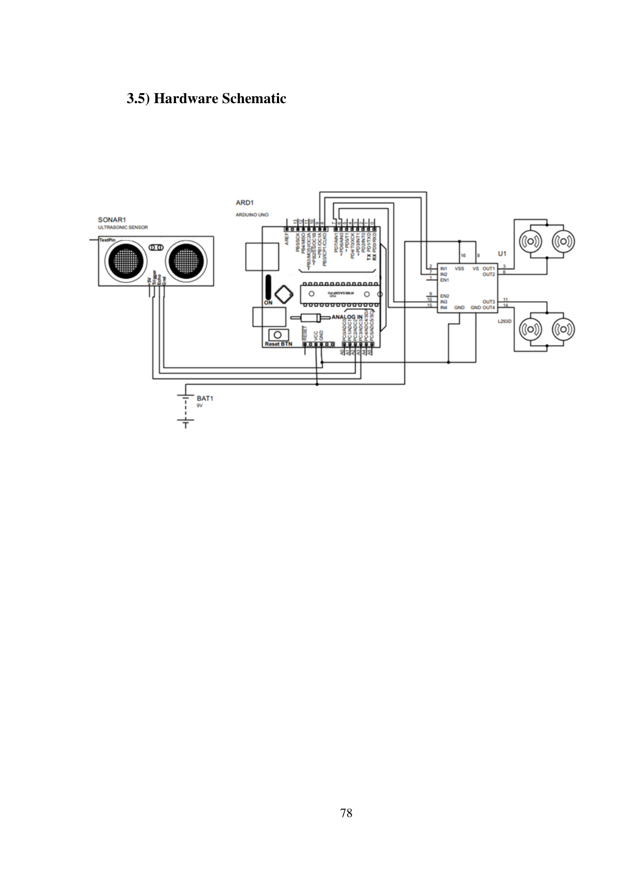

# Electronics — Component Selection

**Evidence:** thesis Appendix 3, hardware schematic and prototype images.

## Documented components

- **Arduino Uno:** embedded controller and digital I/O for motor commands.
- **Ultrasonic ranging sensor:** schematic symbol `SONAR1` for obstacle-distance sensing.
- **Motor driver:** the thesis schematic labels **L293D**, whereas an earlier repository overview said L298. The discrepancy must be resolved against actual prototype photos or original bills of materials; **L293D is the schematic-supported identification**.
- **DC motors:** the schematic shows two output groups with four motor symbols.
- **Power:** the schematic labels `BAT1` as **9 V**. This is a schematic label, not independent confirmation of the actual battery configuration.

## Evidence

*Appendix 3 hardware schematic (PDF page 81, printed page 78). Archival full-page excerpt from the 2021 thesis; see the thesis for original figure numbering.*

## Engineering considerations

Current draw, supply voltage, shared ground, driver dissipation, motor startup current, and wiring must be checked before rebuilding this circuit. The archived schematic is not an independently verified electrical safety or performance assessment.
