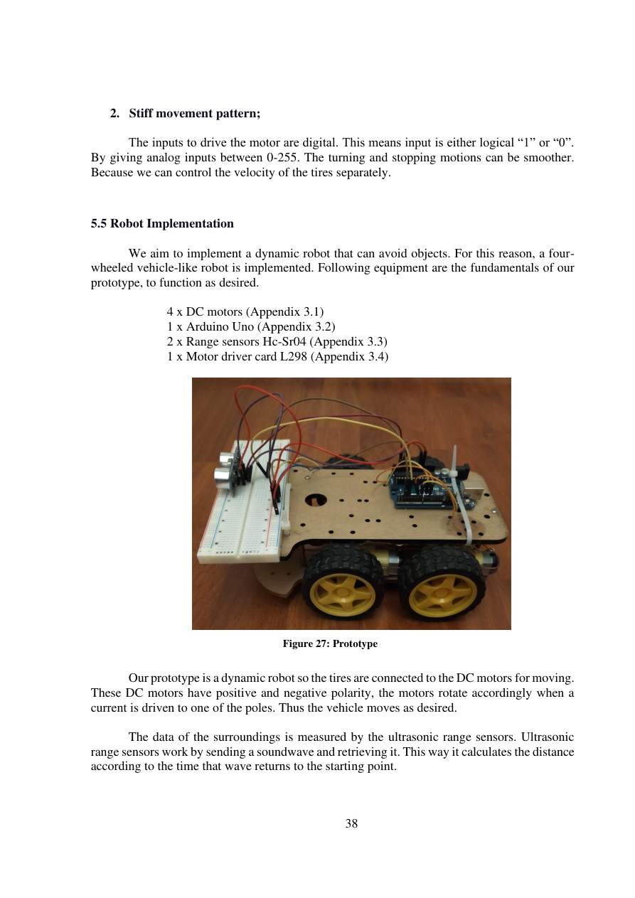
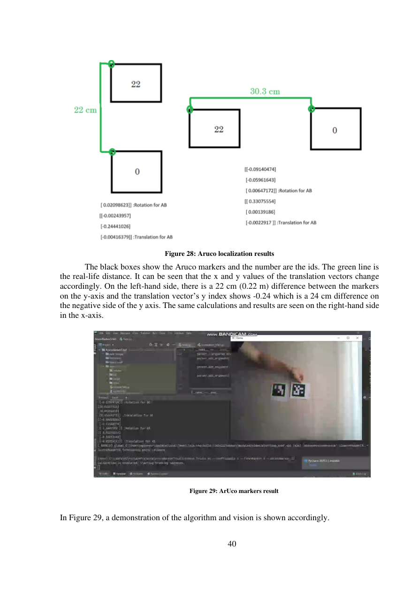

# Physical Prototype — Hardware Integration

The 2021 thesis documents a wheeled mobile robot prototype integrating an Arduino-based controller, motors, an ultrasonic ranging sensor, and a camera/ArUco-based localization experiment.

## Evidence

*Physical robot prototype excerpt (PDF page 41). Archival full-page excerpt from the 2021 thesis; see the thesis for original figure numbering.*

*Robot localization demonstration excerpt (PDF page 43). Archival full-page excerpt from the 2021 thesis; see the thesis for original figure numbering.*

## Scope

Prototype photographs and documented demonstrations are evidence of historical construction and experiments. They are not proof that the MATLAB SLAM simulation, camera localization and Arduino navigation were all deployed as one continuously operating closed-loop system.
