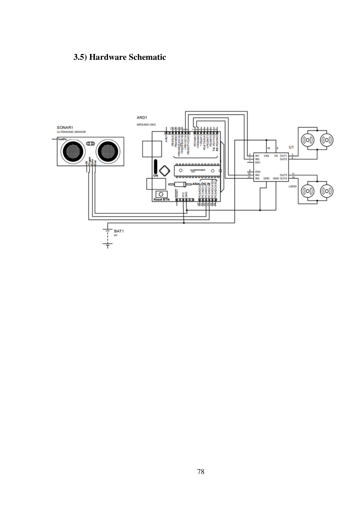

# Circuit Schematic / Proteus Model — Evidence Status

The thesis includes a circuit schematic showing an Arduino Uno, an ultrasonic sensor, a motor driver labeled **L293D**, DC motor symbols and a 9 V battery symbol.

*Hardware schematic from thesis Appendix 3 (PDF page 81). Archival full-page excerpt from the 2021 thesis; see the thesis for original figure numbering.*

## What is verified

The **schematic image exists** in the thesis. The drawing style is consistent with a circuit-design tool, but the source `.pdsprj`/`.dsn` files, simulator settings, simulation traces and successful simulation run are **not available in the reviewed archive**.

## What remains to verify

Locate original Proteus project files or simulation captures. Until then, describe this as a **thesis-documented circuit schematic**, not a reproducible or verified Proteus simulation.
