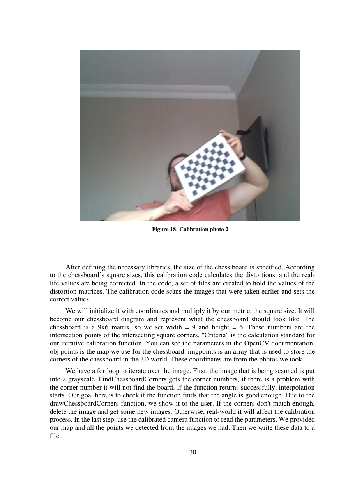

# Python / OpenCV — ArUco Marker Tracking

**Thesis:** Section 4.3. **Code:** [`aruco_localization.py`](../../../legacy/python/aruco_localization.py), function `track()`.

## Method

The code captures frames from `cv2.VideoCapture(0)`, converts them to grayscale, detects markers using `DICT_5X5_1000`, and estimates individual marker poses with `estimatePoseSingleMarkers`. The archived marker IDs are `0` and `22`; the marker-size argument is `0.1` m.

## Evidence

*Physical chessboard/camera calibration excerpt (PDF page 33). Archival full-page excerpt from the 2021 thesis; see the thesis for original figure numbering.*

## Limitations

This is a historical OpenCV API and a thesis-derived transcription, not a currently validated real-time application. A working demo would require a compatible camera, calibration files, markers, code repair, and OpenCV API updates.
