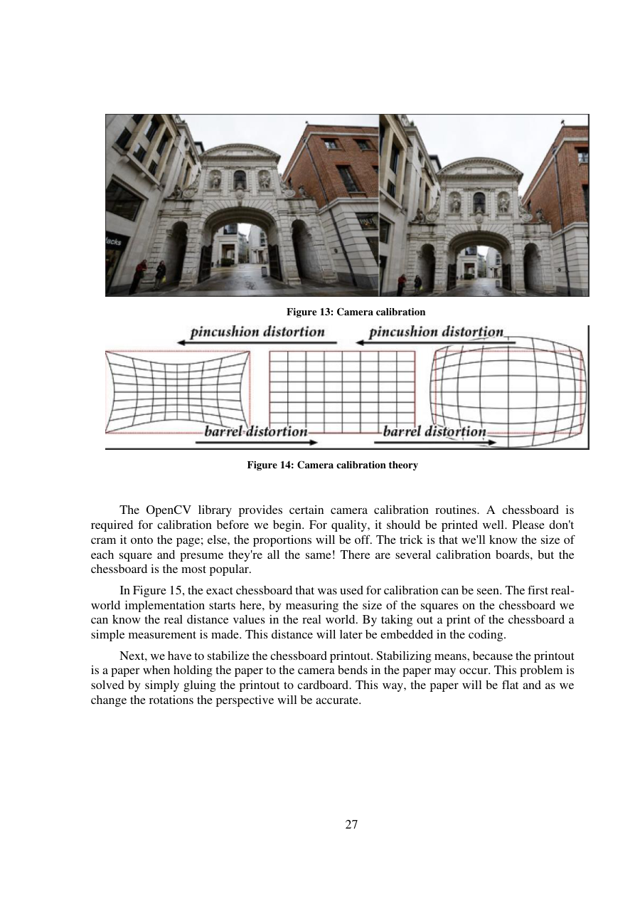

# Python / OpenCV — Camera Calibration

**Thesis:** Section 4.3 and implementation discussion. **Code:** [`aruco_localization.py`](../../../legacy/python/aruco_localization.py), function `calibrate()`.

## Method

The archived Python implementation defines a 9×6 internal-corner chessboard, 0.025 m square spacing, `findChessboardCorners`, `cornerSubPix`, and `calibrateCamera`. `saveCoefficients()` and `loadCoefficients()` store and retrieve the camera matrix and distortion coefficients using OpenCV FileStorage.

## Evidence

*Camera calibration/chessboard thesis excerpt (PDF page 30). Archival full-page excerpt from the 2021 thesis; see the thesis for original figure numbering.*

## Limitations

The `calib_images` dataset and generated `calib_const.yaml` are not included in the reviewed source archive. The transcribed Python file contains indentation and line-wrap defects; this is documentation of the original process, not a runnable calibration tutorial.
