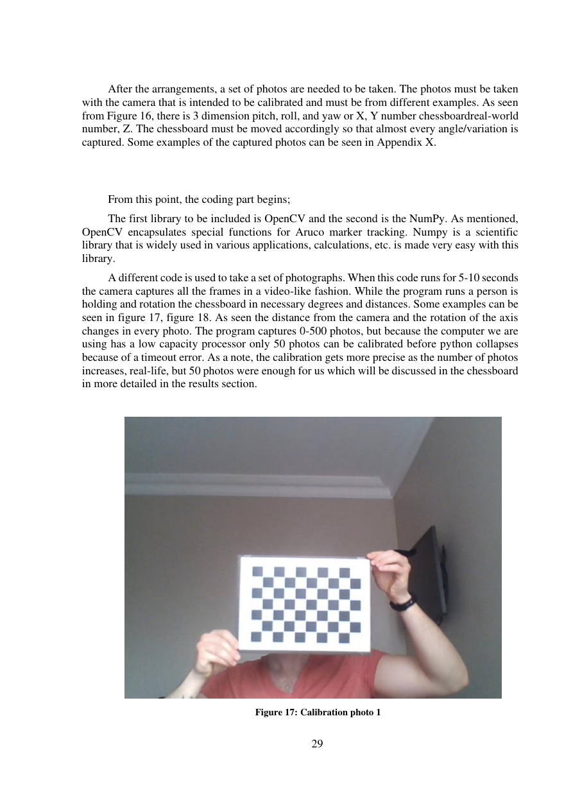
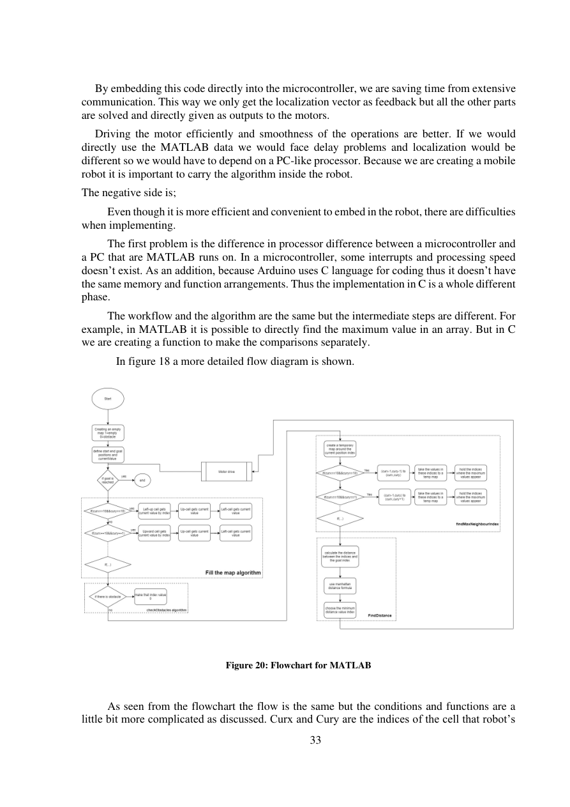

# Python — Relative Pose Estimation

**Thesis:** Section 4.3 and later implementation discussion. **Code:** [`aruco_localization.py`](../../../legacy/python/aruco_localization.py), functions `inversePerspective()`, `relativePosition()`, `stepFunction()`.

## Method

Individual ArUco poses are represented by rotation and translation vectors. `inversePerspective()` inverts a pose and `relativePosition()` composes transformations using `cv2.composeRT`, aiming to express the relative transformation between two markers through their camera-relative poses. `stepFunction()` converts components into a discretized navigation representation.

## Evidence

*Camera/marker coordinate-system excerpt (PDF page 32). Archival full-page excerpt from the 2021 thesis; see the thesis for original figure numbering.*

*Localization algorithm flowchart excerpt (PDF page 36). Archival full-page excerpt from the 2021 thesis; see the thesis for original figure numbering.*

## Limitations

Coordinate-frame conventions, orientation signs, and numerical correctness require a fresh mathematical and test review before this code is reused. Do not interpret these archived functions as validated modern localization software.
