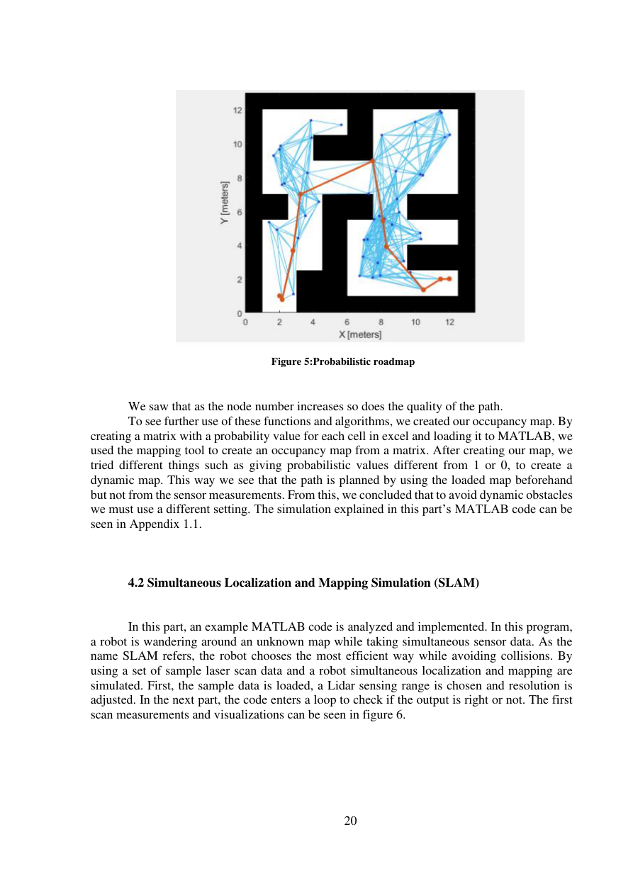

# MATLAB — Path Planning in a Known Map

**Thesis:** Section 4.1. **Code:** [`path_planning_known_map.m`](../../../legacy/matlab/path_planning/path_planning_known_map.m).

## Objective

Investigate planning and simulated motion through a known occupancy-grid environment.

## Method

The archived script constructs `occupancyMap` objects, inflates the map, configures `mobileRobotPRM` (`NumNodes = 120`, `ConnectionDistance = 5`), and requests a path with `findpath`. It also includes a Pure Pursuit control loop and differential-drive kinematics (`derivative(diffDrive, ...)`) with simulated LiDAR measurements and `insertRay` updates.

## Evidence

*Known-map occupancy-grid planning excerpt (PDF page 23). Archival full-page excerpt from the 2021 thesis; see the thesis for original figure numbering.*

## Scope and limitations

This is a MATLAB simulation, **not** proof of PRM or simulated LiDAR running on the physical Arduino robot. The source was reconstructed from the thesis and has not been executed in the current environment. Toolbox and helper dependencies may need restoration.
