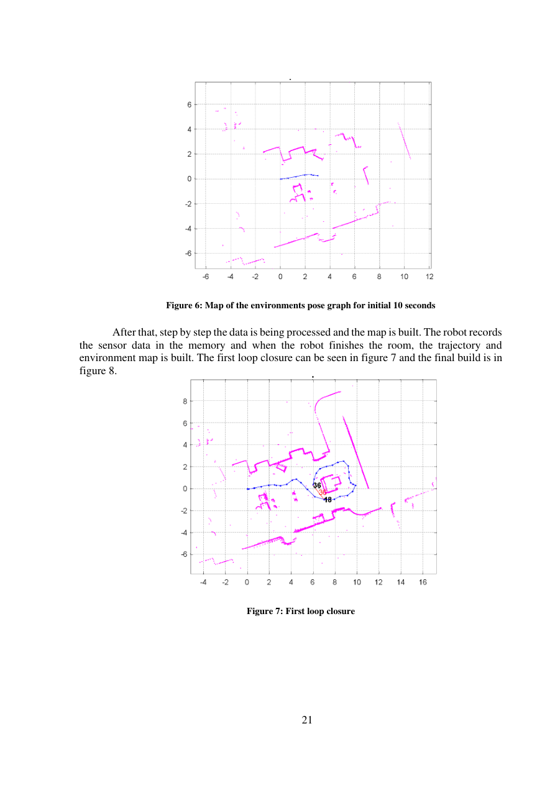
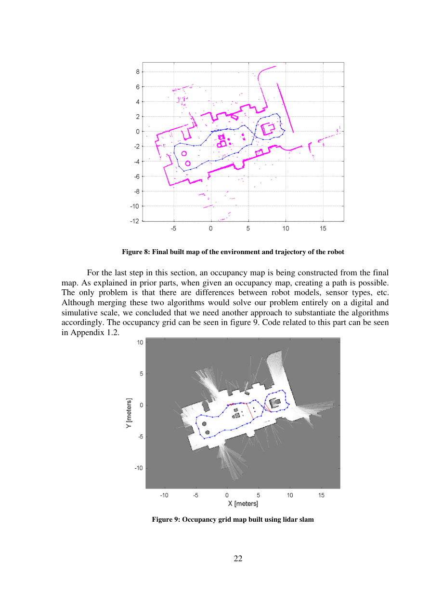

# MATLAB — LiDAR SLAM Simulation

**Thesis:** Section 4.2. **Code:** [`lidar_slam_simulation.m`](../../../legacy/matlab/simulations/lidar_slam_simulation.m).

## Objective

Explore map construction from LiDAR scans and pose-graph optimization in a more advanced simulation than the known-map example.

## Method

The script uses MATLAB's built-in `lidarSLAM` class, `addScan`, loop-closure configuration (`LoopClosureThreshold = 210`, `LoopClosureSearchRadius = 8`), and visualization. The SLAM algorithm is a **MATLAB library capability**, not a custom SLAM implementation.

## Evidence

*LiDAR SLAM scan and mapping excerpt (PDF page 24). Archival full-page excerpt from the 2021 thesis; see the thesis for original figure numbering.*

*SLAM mapping result excerpt (PDF page 25). Archival full-page excerpt from the 2021 thesis; see the thesis for original figure numbering.*

## Scope and limitations

No physical LiDAR deployment is established by the archived evidence. Reproduction requires the original scan dataset and compatible MATLAB toolboxes; these have not been verified as present in this repository.
