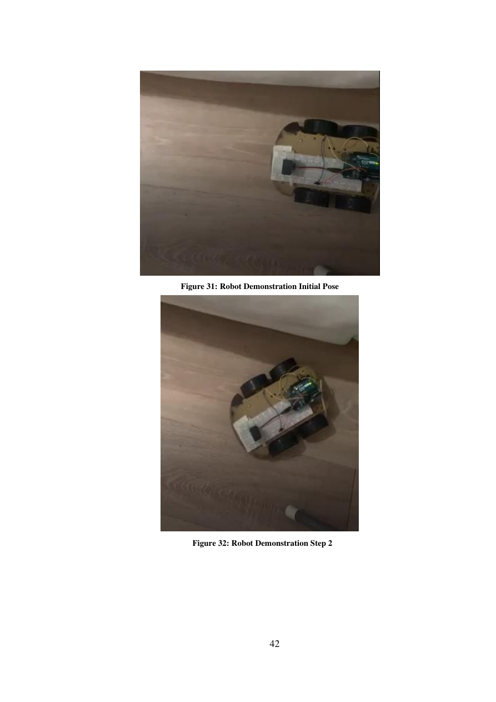

# System Integration and Demonstrations

## 2021 project scope

The physical prototype explored grid navigation, Arduino motor commands, obstacle sensing and camera-based marker localization. The thesis also contains separate MATLAB simulation experiments for PRM/Pure Pursuit planning and LiDAR SLAM.

## Evidence

*Robot navigation demonstration excerpt (PDF page 45). Archival full-page excerpt from the 2021 thesis; see the thesis for original figure numbering.*

## Key integration boundaries

1. **MATLAB simulation vs physical prototype:** do not conflate simulated LiDAR SLAM with onboard sensing.
2. **Python camera localization vs embedded navigation:** the archive does not establish a robust live position-data link to the Arduino navigation code.
3. **Open-loop motion:** the archived motor functions use timed digital output rather than encoder-feedback control.
4. **Historical source status:** code transcribed from the thesis has not been fully revalidated in a contemporary toolchain.

The thesis conclusion explicitly identifies MATLAB–Arduino map transfer and map resolution as remaining challenges. These are appropriate future-work items, not completed features.
